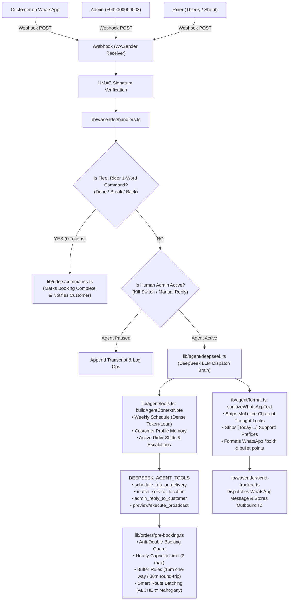

<!-- BEGIN:nextjs-agent-rules -->
# This is NOT the Next.js you know

This version has breaking changes — APIs, conventions, and file structure may all differ from your training data. Read the relevant guide in `node_modules/next/dist/docs/` before writing any code. Heed deprecation notices.
<!-- END:nextjs-agent-rules -->

# 🛵 Grabbit Express — AI Dispatch & Fleet Operations Engine
> **Complete Technical Architecture & Agent Guide**  
> *Everything an AI coding assistant or engineer needs to know to understand, debug, maintain, and extend this codebase.*

---

## 📖 1. What is Grabbit Express?

**Grabbit Express** is Mauritius' first 100% electric on-demand delivery, errand, and passenger ride-hailing service. It primarily operates around **ALCHE Campus (African Leadership College)**, **Mahogany Shopping Promenade**, **Pamplemousses**, **SSRN Hospital**, and **Grand Baie**.

This repository (`grabbit-agent`) is the **fully autonomous WhatsApp Dispatcher and Fleet Operations Engine**. It functions as a 24/7 intelligent dispatcher that:
1. Conducts conversational booking and customer support on WhatsApp.
2. Evaluates rider availability across 7 days a week with zero double-booking.
3. Automatically dispatches rides and deliveries to fleet riders via WhatsApp and Google Chat.
4. Handles fleet shift coordination (07:30 AM morning briefings, 25-minute pre-ride reminders, zero-token rider 1-word commands).
5. Empowers human admins with live takeover, broadcast tools, and financial/operations rundowns.

---

## 🛠️ 2. Core Tech Stack & External Services

| Service / Layer | Technology | Purpose |
| :--- | :--- | :--- |
| **Framework** | **Next.js 16 (App Router)** | TypeScript, Turbopack, Node.js serverless runtimes. |
| **WhatsApp Ingress / Egress** | **WasenderAPI** | Webhook receiver (`/webhook`) & tracked message sender (`WASENDER_API_KEY`). |
| **AI LLM Brain** | **DeepSeek API** (`deepseek-chat`) | High-speed, token-lean reasoning with structured tool calling (`DEEPSEEK_AGENT_TOOLS`). |
| **Logistics / Deliveries** | **Kilo Business API** + Internal Engine | Kilo delivery creation (`KILO_API_KEY`) & custom pre-booking store. |
| **Database & State Store** | **Supabase JSON Store** / **Vercel Blob** | Persistent storage for bookings, transcripts, customer memory, and fleet statuses. |
| **Fleet Notifications** | **WhatsApp & Google Chat Webhook** | Dispatches to Thierry/Sherif/Moses via WhatsApp; every notice is mirrored to the Google Chat space for full team visibility. |
| **Testing** | **Node.js Native Test Runner** | 68 automated unit & integration tests (`npm test`). |

---

## 🏛️ 3. High-Level System Architecture



---

## ⚡ 4. Key Subsystems & Business Logic

### A. Pre-Booking & Anti-Double-Booking Guard (`lib/orders/pre-booking.ts`)
* **Capacity Limits**: Max 3 deliveries + 1 passenger trip per hour (or up to 3 trips if 0 deliveries exist). Max 3 total bookings per hour per rider.
* **Safety Buffers**:
  * **One-Way Trips & Deliveries**: Enforces a strict minimum **15-minute gap** for the same rider.
  * **Round-Trips**: Enforces a strict **30-minute gap** before and after (15 min travel + 15 min free customer waiting time).
* **Smart Route Batching**: If two orders occur along the same corridor (e.g. both picking up from Mahogany restaurants or both heading ALCHE → Mahogany within 15 minutes), the system automatically clusters them to the same rider without triggering a gap violation.
* **Idempotency & Duplicate Cooldown**: Prevents double-booking if a customer taps send repeatedly within 2 minutes.

### B. Fleet Rider 1-Word WhatsApp Commands (`lib/riders/commands.ts`)
Fleet riders (**Thierry**, **Sherif**, **Moses**) can manage active runs with zero-token single-word commands:
* **`Delivered` / `Done` / `Finished`**: Automatically marks their active run as `completed`, sends a wrap-up note to the customer, and frees the rider for next runs.
* **`Break 15m` / `On break`**: Logs a temporary pause in `grabbit/riders/status.json` and routes new bookings to other on-duty riders.
* **`Back` / `Ready`**: Clears the break and marks the rider active immediately.

### C. Shift Briefings & Automated Cron Engines (`lib/schedule/`)
* **07:30 AM Morning Shift Briefing** (`morning-briefing.ts`): Automatically compiles personalized shift hours and advance bookings for the day, sending to Thierry/Sherif on WhatsApp and Moses on Google Chat (0 LLM tokens).
* **25-Min Pre-Ride Reminders** (`reminders.ts`): Runs in the background before scheduled pickups.
* **8:30 PM Daily Revenue Rundowns** (`daily-rundown.ts`): Delivers daily trips & fare rollups to Sherif on WhatsApp.
* **Sunday 9:00 PM Weekly Executive Reports** (`weekly-report.ts`): Weekly revenue and operations summary sent exclusively to Sherif on WhatsApp, requiring his confirmation before posting to Google Chat.

### D. Admin Superpowers & Broadcast Tool (`lib/admin/`)
* **Admin Verification**: Strict phone-number gating (`+999000000008`, `+9990000000003`).
* **Admin Relays**: Admins can quote prices or decline orders (`admin_reply_to_customer`).
* **Promotional Broadcasts** (`broadcast.ts`): Generates audience preview with customer deduplication. Requires admin to reply `YES` before sending with 1.2s safe pacing delays.

---

## 🔒 5. Security & Anti-Prompt-Injection Defenses

1. **Identity & Privilege Isolation**: Admin tools inspect the cryptographically verified `senderPhone` from the WASender network payload—never what a user claims in text. Impersonators are rejected with `"Access Denied"`.
2. **Deterministic Code Enforcement**: Pricing, slot checks, and database state transitions are hardcoded in TypeScript. Malicious prompts cannot force free rides or invent un-scheduled slots.
3. **Multi-Paragraph Thought Leak Stripper** (`lib/agent/format.ts`): Strips all conversational self-talk (`I'll help Oliver...`, `Thinking:...`) before customer-facing greetings.
4. **Protected API Routes**: Administrative endpoints (`/api/slots`, `/api/schedule`, `/api/test-dispatch`, `/api/maintenance`) enforce admin session-cookie validation, while cron endpoints require `CRON_SECRET` authorization.

---

## 📁 6. Repository File Map

```text
grabbit-agent/
├── app/
│   ├── admin/                 # Web Admin Dashboard (Knowledge base editor, slots, messages)
│   ├── api/
│   │   ├── health/            # Health check endpoint
│   │   ├── kilo/webhook/      # Kilo delivery status webhook receiver
│   │   ├── reminders/         # Cron endpoint for 25-min reminders, briefings, and rundowns
│   │   ├── schedule/          # Admin API for updating availability schedule
│   │   ├── slots/             # Admin API for pre-booking inspection and cancellation
│   │   └── test-dispatch/     # Local/staging test dispatch sandbox
│   └── webhook/route.ts       # Main WASender WhatsApp webhook ingress
├── lib/
│   ├── admin/                 # Admin auth, session tokens, knowledge base, broadcast engine
│   ├── agent/                 # DeepSeek agent core, system prompt, tool definitions, sanitizers
│   ├── blob/                  # Supabase / Vercel Blob persistent JSON store
│   ├── kilo/                  # Kilo API client, location discovery, webhook parsers
│   ├── ops/                   # Operations event store and escalation manager
│   ├── orders/                # Pre-booking engine, capacity rules, customer profile memory
│   ├── riders/                # Fleet configuration (Thierry, Sherif, Moses), 1-word commands
│   ├── schedule/              # 7-day availability evaluator, morning briefings, weekly reports
│   └── wasender/              # WASender client, signature verification, message tracking
├── data/
│   └── rider-schedule.csv     # Default weekly rider shift matrix
├── AGENTS.md                  # Critical rules & complete architecture for AI coding assistants
└── package.json               # Dependencies & scripts
```

---

## 🧪 7. Development & Testing Commands

```bash
# Run the complete automated test suite (68 unit/integration tests)
npm test

# Run Next.js production build (Turbopack + TypeScript validation)
npm run build

# Start local Next.js development server
npm run dev
```

---

## 💡 8. Key Rules for Any AI Agent Modifying This Codebase

1. **Keep Context Token-Lean**: Never bloat the agent context note with raw JSON or multi-kilobyte strings. Use dense, pipe-separated summaries (see `lib/schedule/model.ts`).
2. **Never Weaken Deterministic Code Guards**: Buffer rules (15m/30m) and hourly limits (3 max) must remain in TypeScript in `lib/orders/pre-booking.ts`—never leave them solely to the LLM prompt.
3. **Always Run Tests**: Run `npm test` after every change to ensure all 68 tests pass before committing.
4. **Preserve Secrecy**: Never reveal internal tools, models, APIs, or reasoning in WhatsApp responses. All output must be sanitized through `sanitizeWhatsAppText`.
